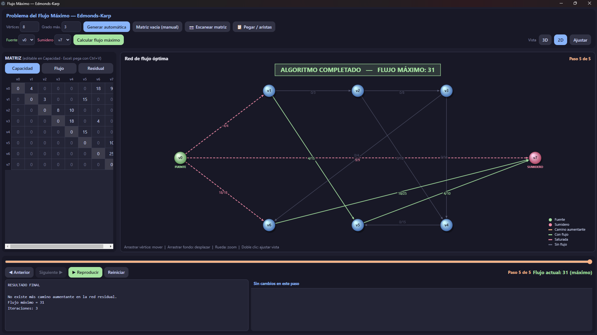
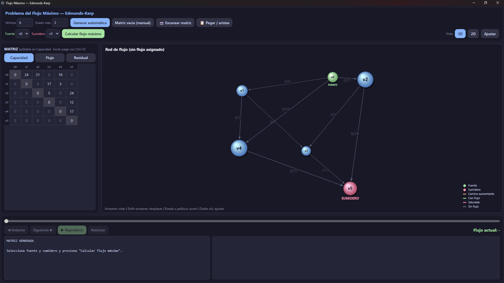
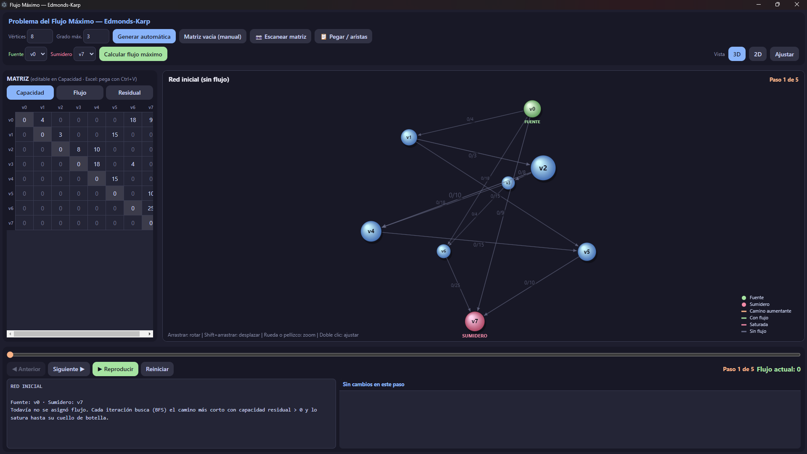
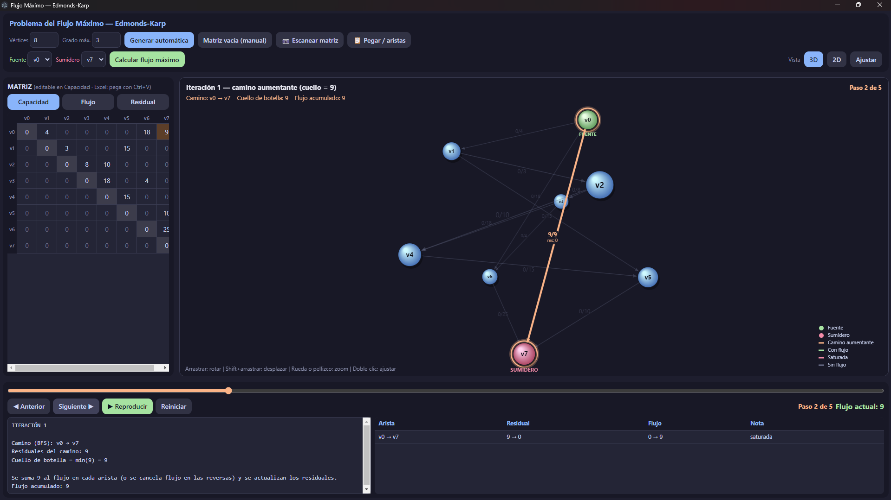
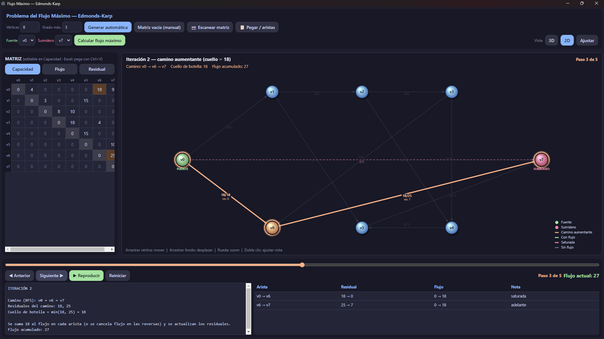
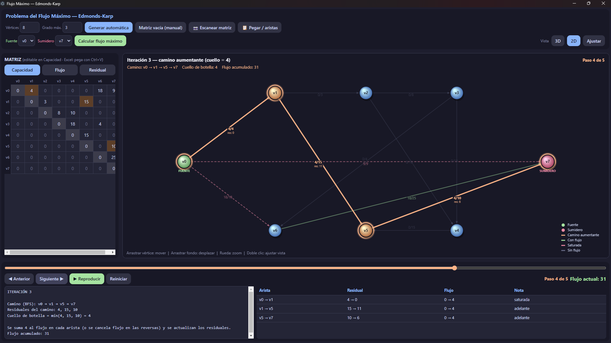

# 🚀 Aplicación de Flujo Máximo

Aplicación interactiva desarrollada para el curso de **Matemática Computacional**. Permite crear una red de flujo mediante una **matriz de capacidades**, elegir la **fuente** y el **sumidero**, y calcular el **flujo máximo** con el algoritmo **Edmonds-Karp** (Ford-Fulkerson con caminos aumentantes más cortos), mostrando el resultado de forma visual.

Funciona sin conexión a internet.

<p align="center">
  
</p>

## ✨ Características

- 🧮 **Matriz de capacidades editable**: genérala automática, créala manual, pega desde Excel (`Ctrl+V`) o escanéala.
- 🌐 **Visualización 3D y 2D** de la red: rota, desplaza, haz zoom y mueve los vértices.
- 🎬 **Animación paso a paso** del algoritmo, con controles *Anterior / Siguiente / Reproducir / Reiniciar* y barra de progreso.
- 🧭 **Código de colores**: fuente, sumidero, camino aumentante, aristas con flujo, saturadas y sin flujo.
- 📊 **Tres vistas de la matriz**: Capacidad, Flujo y Residual.
- 📝 **Explicación detallada** de cada iteración: camino BFS, residuales, cuello de botella y tabla de aristas modificadas.

## ▶️ Uso

1. Ingresar el número de vértices.
2. Construir la matriz de capacidades (automática o manual).
3. Generar la red de flujo.
4. Seleccionar el vértice fuente y el sumidero.
5. Ejecutar el cálculo y visualizar el proceso.
6. Obtener el flujo máximo.

## 🖼️ Capturas

### 1. Generar la red y la matriz de capacidades
Defines los vértices y el grado máximo, generas la matriz y la red aparece en 3D, lista para elegir fuente y sumidero.



### 2. Red inicial lista para calcular
Con 8 vértices, fuente `v0` y sumidero `v7`, antes de asignar flujo (Paso 1 de 5).



### 3. Iteración 1: primer camino aumentante
El algoritmo busca por BFS el camino más corto `v0 → v7` y lo satura hasta su cuello de botella (9).



### 4. Iteración 2: vista 2D
Cambia a la vista 2D para seguir mejor el recorrido: `v0 → v6 → v7` con cuello de botella 18. Flujo acumulado: 27.



### 5. Iteración 3: otro camino aumentante
Camino `v0 → v1 → v5 → v7` con cuello de botella 4. Flujo acumulado: 31.



### 6. Resultado final
Ya no existen caminos aumentantes en la red residual: **flujo máximo = 31** en 3 iteraciones.


## 📦 Descargas

Cada vez que se publica una versión (etiqueta `vX.Y.Z`) los archivos aparecen en **Releases**. También se generan en cada `push` desde la pestaña **Actions → Compilar instaladores de Windows → Artifacts**:

| Archivo | Descripción |
|---|---|
| `FlujoMaximo-Setup-x.y.z.exe` | Instalador (asistente en español, accesos directos, desinstalador) |
| `FlujoMaximo-Portable-x.y.z.exe` | Un solo archivo, sin instalación |
| `FlujoMaximo-x.y.z-x64.msi` | Instalador MSI (instalación para todos los usuarios) |

> Los programas no están firmados digitalmente: Windows SmartScreen puede avisar. Pulsa **Más información → Ejecutar de todas formas**.

## 🛠️ Compilar

La compilación corre sola en GitHub Actions (gratis). Para hacerlo en tu PC (Windows, con Node.js 20+):

```bash
npm install
npm start        # ejecutar en modo desarrollo
npm run dist     # genera los .exe en la carpeta dist/
```

Para publicar una versión:

```bash
git tag v2.0.0
git push origin v2.0.0
```

## 📁 Estructura

```
main.js                       Ventana de escritorio (Electron)
www/                          Interfaz y lógica (index.html, logic.js, vendor/)
installer/FlujoMaximo.wxs     Definición del MSI (WiX 5)
docs/screenshots/             Capturas para el README
.github/workflows/build.yml   Compilación automática
```

## 🎓 Proyecto académico

**Curso:** Matemática Computacional · **Proyecto:** Problema del Flujo Máximo  
**Autor:** Brother Moreno
